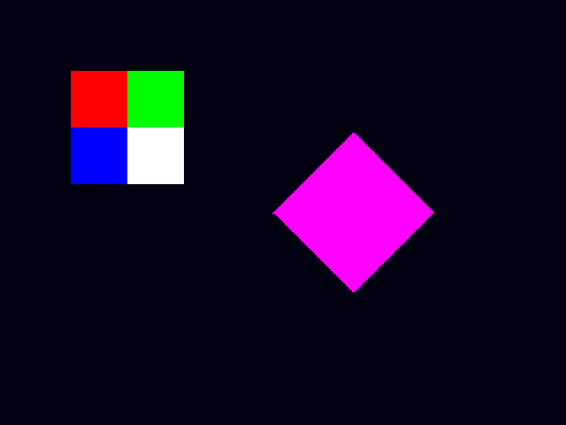

# PlayStation examples

Worked [libpsx](../../doc/tools/psx-sdk.md) samples that run on the original
PlayStation (an R3051 PS-EXE), built by the toolkit's MIPS path and verified on
PCSX-Redux with a real BIOS. The headline demos exist in all four front-end
languages: C (`.c`), Pascal (`.pas`), Kobold (`.kp`), and BASIC (`.bas`). Each
language reaches the same `libpsx` entry points through a thin binding (the C
header directly, `units/psx.pas`, `units/psx/*.kp`, `units/psx.bas`), so the
rendered frame is identical whichever language produced it.

The screenshots below are captured from the BASIC builds (`hello.bas`,
`cube.bas`, `sprite.bas`), the newest binding; see
[the BASIC module guide](../../doc/languages/basic-modules.md) for how `psx.bas`
binds the C library with `EXTERNAL` declarations.

## hello — the GPU

A yellow square bounces across a dark-blue field: GPU bring-up, a flat-colored
rectangle, vsync, and the double buffer.


## cube — 3D through the GTE

A spinning cube: eight corners projected through the GTE each frame, six faces
drawn back to front from the ordering table. No matrix or vertex array crosses
the language boundary; the pointer-free GTE helpers take and return scalars.


## sprite — textures

A texture drawn as a plain sprite and a solid texture drawn rotated, both by
integer handle. The raw TIM pointer stays on the C side in a small accessor
(`sprite_asset.c`); the managed languages draw by handle.



## Building and running

The examples build through the MIPS targets. For the BASIC set:

```sh
make build/psx/hello_bas.exe build/psx/cube_bas.exe build/psx/sprite_bas.exe
```

`make test-basic-psx` structurally validates the BASIC PS-EXEs (part of
`make check-mips-all`). The functional framebuffer runs are opt-in and need
PCSX-Redux and a BIOS:

```sh
make test-basic-psx-redux PSX_BIOS=/path/to/scphXXXX.bin
```

See [the PlayStation toolchain setup](../../doc/tools/psx-setup.md) for the full
install and first-build guide, and [the API reference](../../doc/tools/psx-api.md)
for every entry point and how each language calls it.
